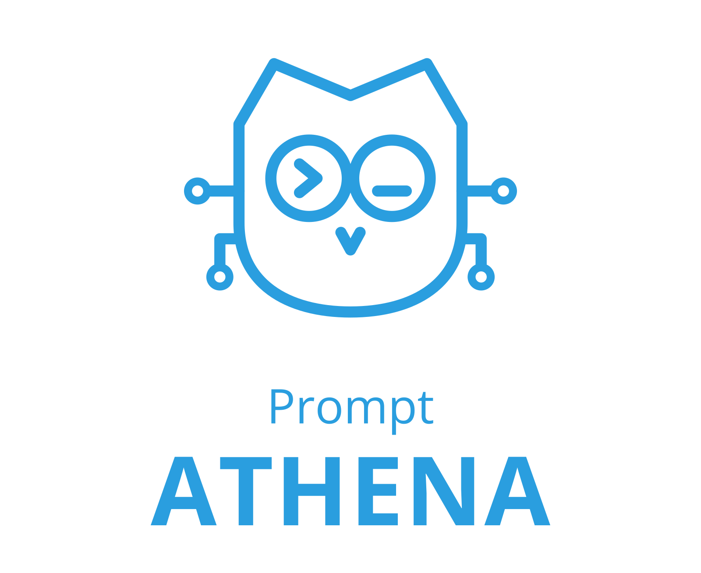
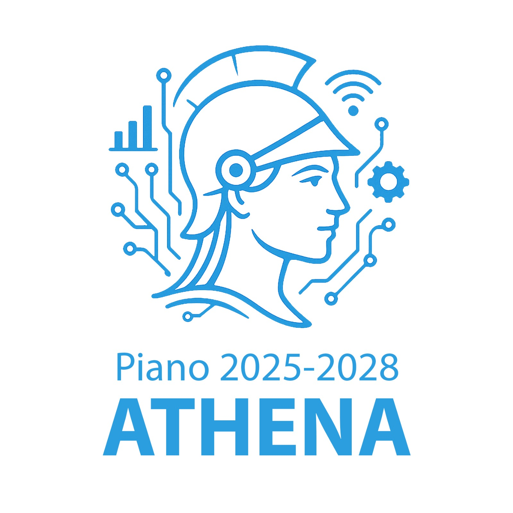

# prompt-athena

  
  &nbsp;&nbsp;&nbsp;&nbsp;
  

➡️ **[Scarica l'ultima release](https://github.com/G-Steam-Bolzano/prompt-athena/releases/latest)** · per [Claude](https://github.com/G-Steam-Bolzano/prompt-athena/releases/latest/download/prompt-athena.skill) · per [Gemini](https://github.com/G-Steam-Bolzano/prompt-athena/releases/latest/download/prompt-athena.zip) · per [Mistral](https://github.com/G-Steam-Bolzano/prompt-athena/releases/latest/download/prompt-athena.zip)

Skill per assistenti IA ([Claude](https://claude.ai), [Gemini](https://gemini.google.com)
e [Mistral](https://chat.mistral.ai))
che aiuta chi lavora attorno alla scuola (docenti, dirigenti e personale
amministrativo, genitori e famiglie) a usare l'IA in modo consapevole: trasforma
una richiesta in un prompt migliore e dà consigli e riferimenti su buone
pratiche didattiche, privacy e normativa IA a scuola.

La skill fa prima una domanda per capire con chi sta parlando, poi segue il
percorso giusto:

- **Docente / insegnante / formatore** — coaching completo: poche domande guida
  e un prompt migliorato per lezioni, verifiche, feedback, inclusione,
  comunicazioni, attività con gli studenti.
- **Dirigente / personale amministrativo** — prompt migliorato (policy,
  circolari, analisi) con consigli di governance (controllo umano, DPIA,
  adozione di strumenti).
- **Genitore / famiglia** — informazioni e consigli su diritti, privacy dei
  minori e a chi rivolgersi, senza costruire prompt.

I riferimenti normativi citati dalla skill sono tratti **solo** dai documenti
di origine e sintetizzati nelle sue schede: la skill non inventa norme e
distingue sempre obbligo da raccomandazione. Non fornisce pareri legali; per i
casi concreti rivolgersi a DPO, dirigente o regolamento d'istituto.

## Installazione su Claude.ai

Claude.ai non aggiorna le skill automaticamente per gli account individuali:
scarica l'ultima versione e importala quando esce un aggiornamento.

### Prerequisiti

- Un account su [Claude.ai](https://claude.ai) con un piano che supporta le
  skill personalizzate.
- L'esecuzione di codice abilitata (serve per far funzionare le skill): la
  trovi in **Settings > Capabilities**. Se non è attiva, le skill non compaiono.

### Passo 1 — Scarica il pacchetto

Scarica il pacchetto della skill:

- **Link diretto all'ultima versione:**
  [prompt-athena.skill](https://github.com/G-Steam-Bolzano/prompt-athena/releases/latest/download/prompt-athena.skill)
  (è un file ZIP e punta sempre alla release più recente).
- Oppure sfoglia tutte le versioni nella pagina
  [Releases](https://github.com/G-Steam-Bolzano/prompt-athena/releases/latest).

> Non serve scompattare il file: Claude accetta lo ZIP così com'è. Su alcuni
> browser (es. Safari) lo ZIP potrebbe aprirsi da solo dopo il download: in quel
> caso ricomprimi la cartella `prompt-athena/` in un unico file ZIP prima di
> caricarla.

### Passo 2 — Apri la gestione delle skill

1. Accedi a [Claude.ai](https://claude.ai).
2. In basso a sinistra apri il menu del tuo account e scegli **Settings**
   (Impostazioni).
3. Vai nella sezione **Capabilities** (Funzionalità).
4. Verifica che **Code execution** (esecuzione di codice) sia attivo.
5. Apri **Skills**.

### Passo 3 — Carica la skill

1. Clicca **Upload skill** (Carica skill).
2. Seleziona il file `prompt-athena.skill` scaricato al Passo 1.
3. Attendi che il caricamento finisca: `prompt-athena` comparirà nell'elenco
   delle skill.
4. Assicurati che l'interruttore della skill sia **attivo** (on).

### Passo 4 — Prova che funzioni

Apri una nuova conversazione e scrivi, per esempio:

> Sono un docente, mi aiuti a scrivere un prompt per una verifica di storia?

Claude dovrebbe attivare `prompt-athena`, farti un paio di domande guida e poi
restituirti un prompt migliorato con una nota di attenzione.

## Installazione su Gemini

Gemini usa lo stesso formato skill di Claude: carichi lo stesso pacchetto.
Le skill di Gemini sono disponibili sull'app mobile, sull'app per Mac e sul web
(gemini.google.com) e si possono usare anche senza abbonamento a pagamento.

### Passo 1 — Scarica il pacchetto

Scarica il pacchetto per Gemini (formato `.zip`):

- **Link diretto all'ultima versione:**
  [prompt-athena.zip](https://github.com/G-Steam-Bolzano/prompt-athena/releases/latest/download/prompt-athena.zip)
- Oppure dalla pagina [Releases](https://github.com/G-Steam-Bolzano/prompt-athena/releases/latest).

### Passo 2 — Carica la skill

1. Vai su [gemini.google.com](https://gemini.google.com) e apri la pagina
   **Skills**.
2. In alto clicca **Upload** (Carica).
3. Seleziona il pacchetto scaricato. Se Gemini accetta solo cartelle, scompatta
   prima lo `.zip` e seleziona la cartella `prompt-athena` risultante (quella
   che contiene direttamente `SKILL.md`).
4. Rivedi nome, descrizione e istruzioni e clicca **Crea**.
5. Assicurati che la skill sia **attiva**: Gemini la usa automaticamente quando
   è pertinente, oppure la richiami con `/` (o `@`) e la selezioni.

### Passo 3 — Prova che funzioni

In una chat scrivi, per esempio:

> Sono un docente, mi aiuti a scrivere un prompt per una verifica di storia?

> Nota: su Gemini la skill non si condivide con un link pubblico. Per diffonderla
> si distribuisce il pacchetto (questo repo): ogni persona lo scarica e lo
> carica nella propria pagina Skills.

## Installazione su Mistral (Vibe, Work > Skills)

Mistral Vibe supporta le Skills secondo lo standard Agent Skills: carichi la
stessa **cartella** della skill usata per Claude e Gemini (quella con `SKILL.md`
nella radice più `references/` e `fonti/`). Gli agenti di Le Chat sono legacy e
non vengono usati.

### Passo 1 — Scarica il pacchetto

Scarica il pacchetto (formato `.zip`) e, se serve, scompattalo per ottenere la
cartella `prompt-athena` (quella che contiene direttamente `SKILL.md`):

- **Link diretto all'ultima versione:**
  [prompt-athena.zip](https://github.com/G-Steam-Bolzano/prompt-athena/releases/latest/download/prompt-athena.zip)
- Oppure dalla pagina [Releases](https://github.com/G-Steam-Bolzano/prompt-athena/releases/latest).

### Passo 2 — Importa la cartella della skill

1. In Mistral Vibe vai su **Contesto > Skills**.
2. Clicca **Importa**.
3. Seleziona la **cartella della skill** `prompt-athena` (quella che contiene
   direttamente `SKILL.md`). Title, Description e istruzioni vengono letti dalla
   skill; i file di `references/` e `fonti/` sono i file di supporto.

### Passo 3 — Prova che funzioni

Richiama la skill con `/prompt-athena` e scrivi, per esempio:

> Sono un docente, mi aiuti a scrivere un prompt per una verifica di storia?

### Esempi d'uso

- "Preparami una lezione di scienze sui vulcani per la 1ª media."
- "Veloce: dammi un prompt per esercizi di grammatica, 1ª superiore."
- "Come dirigente devo scrivere una circolare sulla policy IA ai docenti."
- "Sono un genitore, la scuola userà l'IA in classe: i dati di mio figlio sono
  al sicuro?"

La skill chiede con chi sta parlando se non è chiaro e segue il percorso giusto
(docente / dirigente / genitore). La guida completa è in `mistral/SETUP.md`.

## Come usare la skill

Scrivi semplicemente cosa ti serve, in linguaggio naturale. La skill capisce da
sola quando intervenire; se non è chiaro con chi sta parlando, te lo chiede.

**Se sei un docente**, descrivi l'attività e lascia che ti guidi:

> Devo preparare una verifica di matematica per la seconda media, 50 minuti.

La skill ti farà poche domande (obiettivo, tempo, tipologia di quesiti,
eventuali strumenti compensativi o misure dispensative senza dati personali) e ti restituirà un prompt
pronto da copiare, una nota di attenzione (privacy, cosa controllare tu) e un
breve "cosa è cambiato".

**Se sei un dirigente o del personale amministrativo**, chiedi supporto su
documenti e processi:

> Mi serve una bozza di circolare per annunciare la policy sull'IA ai docenti.

Oltre al prompt migliorato riceverai consigli di governance (controllo umano
sulle decisioni, trasparenza, quando serve una valutazione d'impatto).

**Se sei un genitore**, fai la tua domanda:

> La scuola di mio figlio userà l'IA in classe: i suoi dati sono al sicuro?

La skill risponde con informazioni e consigli su diritti e privacy dei minori,
e ti indica a chi rivolgerti (docente, dirigente, DPO). In questo caso non
costruisce prompt.

### Consigli per ottenere di più

- Non inserire mai dati personali nei messaggi: niente nomi, voti, diagnosi,
  parti di PEI/PDP o documenti riservati. Descrivi i bisogni in forma generica.
- Se vuoi saltare le domande, scrivi "veloce" o "senza domande": la skill farà
  delle assunzioni e produrrà subito il risultato (ma ti chiederà comunque chi
  sei se non riesce a capirlo).
- Il prompt che ottieni è un punto di partenza: i contenuti e la valutazione
  restano sempre responsabilità tua.

## Aggiornare la skill

Gli assistenti non aggiornano le skill da soli per gli account individuali.
Quando esce una nuova versione, scarica di nuovo il pacchetto e ricaricalo:

- **Claude:** in **Settings > Capabilities > Skills** rimuovi la versione
  precedente di `prompt-athena` e carica il nuovo `prompt-athena.skill`.
- **Gemini:** nella pagina **Skills** ricarica il pacchetto `prompt-athena.zip`
  (o la cartella), oppure chiedi a Gemini di aggiornare la skill e i suoi file.
- **Mistral:** in **Contesto > Skills** reimporta la cartella aggiornata della
  skill con **Importa**. I dettagli sono in `mistral/SETUP.md`.

Per sapere quale versione hai, puoi chiedere all'assistente la versione della
skill `prompt-athena`.

## Problemi comuni

- **Non vedo "Skills" nelle impostazioni:** abilita prima **Code execution** in
  Capabilities; se ancora non appare, il tuo piano potrebbe non supportare le
  skill personalizzate.
- **Il caricamento viene rifiutato:** controlla di star caricando un file ZIP
  (`.skill` è uno ZIP) e che al suo interno ci sia la cartella `prompt-athena/`
  con dentro `SKILL.md`.
- **La skill non si attiva da sola:** descrivi la richiesta in modo esplicito
  (es. "aiutami a scrivere un prompt per la scuola") o verifica che
  l'interruttore della skill sia attivo.

## Fonti e licenza dei documenti

I consigli della skill derivano da documenti ufficiali. Attualmente:

- *Intelligenza artificiale, scuola e formazione* — Provincia autonoma di
  Bolzano, Direzione Istruzione e Formazione italiana (gruppo "Athena"),
  documento aggiornato al 24 agosto 2026, distribuito con licenza
  [CC BY-SA 4.0](https://creativecommons.org/licenses/by-sa/4.0/).

## Autore
Leonardo Martino ([@spawn81](https://github.com/spawn81)), per il Gruppo Steam della Provincia Autonoma di Bolzano.

## Licenza della skill
La skill (`SKILL.md`, `references/` e questo README) è distribuita con licenza
[CC BY-SA 4.0](https://creativecommons.org/licenses/by-sa/4.0/deed.it): puoi
riusarla e modificarla citando la fonte e mantenendo la stessa licenza. Il testo
completo è nel file [LICENSE](LICENSE).

La skill non fornisce pareri legali. Per i casi concreti rivolgersi a DPO,
dirigente o regolamento d'istituto.
